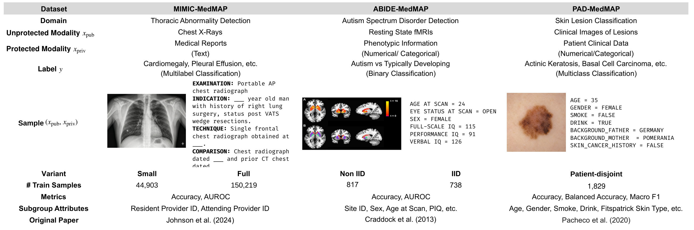

# MedMAP: A Medically Grounded Multi-Modal Benchmark for Modality-Asymmetric Privacy

MedMAP is a benchmark and PyTorch/Hugging Face code base for training
multi-modal medical models when **one modality needs stronger privacy
protection than the others**, introduced in
[this ML4H 2026 paper](https://github.com/cerai-iitm/MedMAP#citation).

## The setting

Clinical decisions are rarely made from a single source of data. A radiologist
reads a chest X-ray together with the referral note and the patient's history;
a dermatologist looks at a lesion and asks about family cancer history, sun
exposure and smoking; a psychiatrist combines brain imaging with cognitive
test scores and demographics. Machine learning models that see the same
combination of modalities usually outperform models that see imaging alone.
The extra signal, however, lives in exactly the data that is most sensitive:
free-text reports can reveal incidental findings, comorbidities and
stigmatised conditions, and tabular records carry demographics, lifestyle and
family history. De-identified images are routinely shared for research; the
accompanying patient data often is not, so models are built without it.

MedMAP studies this **modality-asymmetric privacy** setting: a public modality
(imaging) that can be used freely, a protected modality (text or tabular
patient data) that must be protected, and a label to predict. The question is
whether a model can use the protected modality to improve its predictions
while giving a formal guarantee that the protected modality itself cannot be
recovered from the trained model.

## Differential privacy, briefly

Removing names and identifiers from a training set does not stop a trained
model from leaking what it saw. A model can memorise individual records, and an
attacker who already knows a patient's X-ray and diagnosis can probe the model
to infer what the patient's report or questionnaire said. **Differential
privacy (DP)** is the standard way to rule this out with mathematics rather
than with a list of known attacks. A training procedure is differentially
private if changing one patient's record changes the distribution of the
resulting model only slightly. The privacy budget **ε** (epsilon) quantifies
"slightly": smaller ε is stronger protection, and ε around 1 to 8 is typical in
practice. Because the guarantee holds for any attacker, present or future, it
is the kind of protection that governance boards and data use agreements can
reason about.

DP is implemented during training by clipping the influence of each record on
the model update and adding calibrated random noise (DP-SGD). The price is
utility: noise hurts accuracy, and it hurts most for small datasets, rare
classes and small subgroups. MedMAP uses two flavours. **Full DP-SGD** protects
the entire record, including the imaging that could have been used freely.
**Feature DP** protects only the designated modality: the part of the gradient
attributable to the protected modality is clipped and noised, while the part
coming from the public modality is used as is. This gives a formal guarantee
that an attacker who knows the image and the label still learns almost nothing
new about the report or questionnaire, at a lower utility cost than protecting
everything.

## What MedMAP provides

<p align="center">
  
</p>
<p align="center"><em>Figure 1: the three clinical tasks in MedMAP. Each pairs an unprotected imaging modality with a protected text or tabular modality.</em></p>

**Features**:

- Three medically grounded multi-modal datasets (MIMIC-CXR, ABIDE I,
  PAD-UFES-20) prepared with fixed, patient- or site-disjoint splits,
  leakage-controlled preprocessing (the report sections that generated the
  labels are removed and label vocabulary is masked; label-revealing metadata
  fields are dropped) and task-appropriate metrics, plus a public
  non-medical proxy (Tiny ImageNet + captions) for development.
- Four standard arms on identical pipelines: unprotected-modality-only,
  non-private multi-modal, full DP-SGD and Feature DP.
- Feature DP for Hugging Face vision-language models (Gemma 3 4B, MedGemma 4B,
  SmolVLM) through a modified `dp-transformers`/Opacus trainer, and for small
  models (logistic regression, MLP) through compact NumPy/`torch.func` loops.
- Privacy accounting with Google's `dp-accounting` RDP accountant; the noise
  multiplier is calibrated to a target (ε, δ) per run.
- Subgroup and per-class evaluation (provider IDs, acquisition site, sex, age,
  IQ, skin type, family history, class-wise FPR/FNR) so that aggregate
  privacy-utility curves can be checked against heterogeneous subpopulations.
- Scaled-down settings (dataset shards, small models, LoRA) that run on one
  commodity GPU within a day, and an MNIST-sized toy example that runs on a
  CPU in minutes.
- A small forward contract (`public= / feature_dp= / loss_mode=`) that makes new
  models and datasets drop into the same trainers and accounting.

### Datasets and tasks

| Dataset | Task | Unprotected modality | Protected modality | Model | Guide |
| --- | --- | --- | --- | --- | --- |
| MIMIC-MedMAP ([MIMIC-CXR](https://physionet.org/content/mimic-cxr/2.1.0/) + [MIMIC-CXR-JPG](https://physionet.org/content/mimic-cxr-jpg/2.1.0/)) | 12 thoracic findings, multi-label; exact-match accuracy, macro AUROC | chest X-ray | leakage-filtered radiology report (text) | Gemma 3 4B or MedGemma 4B, LoRA (`--backbone gemma\|medgemma`) | [docs/mimic_cxr.md](docs/mimic_cxr.md) |
| ABIDE-MedMAP ([ABIDE I](http://fcon_1000.projects.nitrc.org/indi/abide/)) | autism vs. typically developing, binary; accuracy, AUROC | resting-state fMRI connectivity | phenotypic record (age, sex, IQ, ...) | logistic regression (NumPy/Numba and Hugging Face backends) | [docs/abide.md](docs/abide.md) |
| PAD-MedMAP ([PAD-UFES-20](https://data.mendeley.com/datasets/zr7vgbcyr2/1)) | six skin lesion classes; accuracy, balanced accuracy, macro F1, per-class FPR/FNR | smartphone lesion photo (frozen EfficientNet-B3 features) | clinical questionnaire (114-d one-hot) | one-hidden-layer MLP | [docs/pad_ufes.md](docs/pad_ufes.md) |
| Tiny ImageNet + [ImageNet-Captions](https://github.com/mlfoundations/imagenet-captions) (public proxy) | 200 classes | image | Flickr caption | SmolVLM-256M, LoRA | [docs/imagenet.md](docs/imagenet.md) |

Variants: MIMIC-MedMAP Small (shards p10 to p12; 44,903 / 427 / 591 studies)
and Full (p10 to p19; 150,219 / 1,224 / 2,450); ABIDE-MedMAP site-aware
non-IID (817 training subjects) and IID (738); PAD-MedMAP patient-disjoint
(1,829 / 230 / 239). No dataset content is redistributed here; every guide
walks through access, download, layout, preprocessing, training and the
required citations and licence terms.

### Implemented algorithms

| Arm | What is trained on | Privacy mechanism | Where |
| --- | --- | --- | --- |
| Unprotected only | x_pub | none (never sees x_priv) | all training scripts (`--include_img`, `METHOD=lbfgs`, `MODE=sgd`, ...) |
| Non-private multi-modal | (x_pub, x_priv) | none; utility ceiling | same |
| DP-SGD | (x_pub, x_priv) | per-example gradient clipped to C, Gaussian noise σC; protects the whole record | `library/dp-transformers` (`--use_dp --no-feature_dp`), `medmap/pad/privacy.py`, `medmap/abide_classic/*full_dp.py` |
| Feature DP (FDP-SGD) | (x_pub, x_priv) | gradient split into a public component (x_priv removed) and a protected residual; separate clip norms C_pub / C_priv, noise σC_priv on the residual only; protects x_priv | `library/dp-transformers` (`--use_dp --feature_dp`), `medmap/pad/privacy.py`, `medmap/abide_classic/*feat_dp.py` |

All private arms use add/remove-one adjacency at the record level (one study,
one subject or one lesion image), the RDP accountant from `dp-accounting`, and
δ = n^-1.1 unless noted in the dataset guide. Mini-batch DP-SGD with Poisson
accounting is used for MIMIC; ABIDE and PAD use full-batch gradient descent.

## Installation

```bash
git clone https://github.com/cerai-iitm/MedMAP.git && cd MedMAP
conda create -n medmap python=3.11 -y && conda activate medmap

# Reference environment (exact pins used for the reported results):
pip install -r requirements.txt
# ...or a flexible install:
pip install -e ".[all]"
```

The vendored dp-transformers fork is picked up automatically when running
via `python -m scripts.<name>` or `python -m examples.<name>` from the
repository root (a small bootstrap adds `library/dp-transformers/src` to
`sys.path`). To use it outside the repo: `pip install -e library/dp-transformers`.

Hardware: Gemma 3 / MedGemma fine-tuning was run on a single NVIDIA L40S
(48 GB, bf16, LoRA); ABIDE, PAD and Tiny ImageNet fit on much smaller GPUs;
the ABIDE classic backend and the toy example run on a CPU.

## Quick start

The fastest way to see all four arms side by side needs no credentialed data:

```bash
python -m examples.toy_feature_dp          # MNIST, a few minutes on a CPU
```

It trains the unprotected-only, non-private, DP-SGD and Feature DP arms on a
two-modality MNIST task (details under [Extending MedMAP](#extending-medmap))
and prints a summary such as

```
  image-only     89.3   (floor: never sees x_priv)
  both           93.8   (ceiling: non-private)
  dp-sgd         86.6   (protects everything, eps=2.0)
  feature-dp     92.9   (protects x_priv only, eps=2.0)
```

For the medical datasets, all four use the same repository-local workspace.
Create it once; paths can be moved without editing scripts by setting
`MEDMAP_DATA_ROOT`, `MEDMAP_MODEL_CACHE` and `MEDMAP_OUTPUT_ROOT` first:

```bash
bash scripts/setup_workspace.sh
```

The complete cold-start workflow, exact directory tree, access requirements
and override examples are in **[docs/data_layout.md](docs/data_layout.md)**.
The shortest per-dataset sequence is:

```bash
# MIMIC-CXR: complete both PhysioNet DUAs first; accept the Gemma 3 / MedGemma
# model terms on Hugging Face for the backbone you pick
PHYSIONET_USER=your_username bash scripts/download_mimic_cxr.sh
bash scripts/prepare_mimic_cxr.sh
MIMIC_BACKBONE=gemma bash examples/run_mimic_non_private.sh      # google/gemma-3-4b-pt
MIMIC_BACKBONE=gemma TARGET_EPSILON=1 bash examples/run_mimic_private.sh   # Feature DP

# ABIDE I: download C-PAC data and extract connectivity features
bash scripts/prepare_abide.sh
SPLIT=non_iid METHOD=lbfgs bash examples/run_abide_classic.sh
SPLIT=non_iid METHOD=feat_dp TARGET_EPSILON=8 bash examples/run_abide_classic.sh

# PAD-UFES-20: download, validate, and cache EfficientNet features
bash scripts/prepare_pad_ufes_20.sh
MODE=sgd bash examples/run_pad.sh --use_metadata --epochs 100
MODE=feature_dpsgd TARGET_EPSILON=8 bash examples/run_pad.sh

# Tiny ImageNet: accept ImageNet/Kaggle terms and configure Kaggle first
bash scripts/download_tiny_imagenet.sh
bash examples/run_imagenet_non_private.sh --validate-only
bash examples/run_imagenet_non_private.sh --epochs 5
```

Every launcher forwards additional arguments to its Python CLI. W&B is
disabled by default; enable it explicitly when desired (`docs/wandb.md`).

## Repository overview

```
medmap/                      the Python package
├── common/                  seeding, env helpers, shared utilities
├── datasets/
│   ├── mimic_cxr/           image selection, leakage-filtered report
│   │                        extraction (vendored official CheXpert/NegBio/
│   │                        mimic-code resources), cached dataset builder
│   ├── abide/               HF data pipeline + packaged feature lists
│   └── imagenet/            ImageNet-Captions builder + fixed split indices
├── models/                  gemma (Gemma 3 4B / MedGemma 4B), smolvlm,
│                            abide_linear, pad_mlp; unified forward contract
│                            (public= / feature_dp= / loss_mode=) so models are
│                            swappable under one DP trainer; mimic_backbones
│                            holds the per-backbone presets
├── training/                trainers (standard + DP), collators, callbacks,
│                            metrics
├── abide_classic/           faithful packaging of the original ABIDE
│                            research scripts (sklearn LBFGS + NumPy/Numba
│                            DP-GD & Feature-DP + summarizers)
└── pad/                     PAD-UFES-20 pipeline (features, DP loops)

scripts/                     Python entry points plus workspace/download/
                             preprocessing shell helpers
examples/                    one-run launchers (forward "$@") and the toy
                             two-modality MNIST example
docs/                        data-layout guide, per-dataset guides, figures
library/dp-transformers/     vendored, MODIFIED dp-transformers fork: the
                             DP/Feature-DP trainer (see MODIFICATIONS.md)
tests/                       unit tests (report leakage filtering)
```

## Extending MedMAP

Adding a dataset or a model takes three pieces: a dataset or collator that
yields a dict of tensors with a `labels` key, a model that honours the forward
contract below, and one call to `medmap.training.trainers.get_trainer`. The
DP trainer, the Feature DP step and the privacy accounting are reused as they
are. [`examples/toy_feature_dp.py`](examples/toy_feature_dp.py) is a complete,
runnable instance of all three on an MNIST-sized problem; the pieces are
summarised here.

**The task.** The public modality is the MNIST digit average-pooled to a
coarse 7×7 grid (an imperfect "image"); the protected modality is a one-hot
"clinical hint" of the digit that is wrong 20% of the time (informative, but
the thing to protect); the label is the digit.

```python
class TwoModalityDataset(torch.utils.data.Dataset):
    def __getitem__(self, i):
        return {"public_features": self.public[i],     # 49-d pooled image
                "private_features": self.private[i],   # 10-d noisy hint
                "labels": self.labels[i]}

def collate(features):
    return {k: torch.stack([f[k] for f in features]) for k in features[0]}
```

**The forward contract.** The model receives the batch dict plus three
keyword arguments and returns `{"loss": ..., "logits": ...}`:

| `loss_mode` | `public` | `feature_dp` | loss the model must return |
| --- | --- | --- | --- |
| `"standard"` | | | ordinary loss on (x_pub, x_priv); non-private training |
| `"decomposed"` | `True` | | loss with x_priv removed (zeroed / null text); the public component |
| `"decomposed"` | `False` | `True` | loss(x_pub, x_priv) − loss(x_pub, null); the protected residual |
| `"decomposed"` | `False` | `False` | loss(x_pub, x_priv); full DP-SGD |

```python
class TwoModalityMLP(nn.Module):
    def forward(self, public_features, private_features, labels=None,
                public=False, feature_dp=False, loss_mode="standard", **kwargs):
        x_full = torch.cat([public_features, private_features], -1)
        x_pub = torch.cat([public_features, torch.zeros_like(private_features)], -1)
        if self.training and loss_mode == "decomposed":
            # Opacus records per-sample gradients only if the first layer's input requires grad.
            x_full, x_pub = x_full.detach().requires_grad_(True), x_pub.detach().requires_grad_(True)
        ce = lambda z: F.cross_entropy(z, labels)
        if loss_mode == "standard" or not (public or feature_dp):
            logits = self.net(x_full); loss = ce(logits)              # non-private or DP-SGD
        elif public:
            logits = self.net(x_pub);  loss = ce(logits)              # public component
        else:
            logits, logits_pub = self.net(x_full), self.net(x_pub)
            loss = ce(logits) - ce(logits_pub)                        # Feature DP residual
        return {"loss": loss, "logits": logits}
```

Run only the forwards that feed the loss: an unused extra forward through the
same module breaks Opacus's per-sample gradient bookkeeping. The DP trainer
differentiates the returned loss per example, clips the public and protected
components with their own norms, and adds noise scaled by the protected clip
norm only. For a vision-language model the "null" protected input is a prompt
with the text removed; because image tokens never attend to text tokens, the
residual can be computed from a single fused forward
(`medmap/models/gemma.py`).

**The trainer.**

```python
from transformers import TrainingArguments
from dp_transformers.arguments import PrivacyArguments
from medmap.training.trainers import get_trainer

trainer = get_trainer(
    use_dp=True, loss_mode="decomposed",
    model=TwoModalityMLP(public_dim=49),
    args=TrainingArguments(output_dir="out", num_train_epochs=10, learning_rate=5e-3,
                           per_device_train_batch_size=600,   # logical (expected) batch
                           gradient_accumulation_steps=6,     # -> physical microbatch of 100
                           remove_unused_columns=False, report_to=[]),
    train_dataset=train_ds, data_collator=collate,
    privacy_args=PrivacyArguments(
        per_sample_max_grad_norm=1.0 / 600,   # clip norms are divided by the logical batch
        public_clip=50.0 / 600,               # (the trainer clips microbatch-mean per-sample grads)
        target_epsilon=2.0, target_delta=len(train_ds) ** -1.1,
        feature_dp=True),                     # False -> full DP-SGD
)
trainer.model_accepts_loss_kwargs = False
trainer.train()
```

`use_dp=False, loss_mode="standard"` gives the non-private arms with the same
model and data. `medmap/models/abide_linear.py` is the smallest production
example of the contract; `medmap/models/gemma.py` shows it for a VLM;
`medmap/pad/privacy.py` shows the same decomposition written as a stand-alone
`torch.func` loop for cases where the Hugging Face trainer is unnecessary.

## Experiment guide

Every experiment follows the same workflow: **download → preprocess once →
run the arm(s) you need → aggregate**. The tables below route you to the
right command and doc section for each step.

### MIMIC-CXR (Gemma 3 4B / MedGemma 4B): [docs/mimic_cxr.md](docs/mimic_cxr.md)

| To do this... | Go here |
| --- | --- |
| Choose the backbone | `MIMIC_BACKBONE=gemma` (google/gemma-3-4b-pt, main paper results) or `MIMIC_BACKBONE=medgemma` (google/medgemma-4b-pt, default) in front of either launcher; equivalently `--backbone` on `scripts/train_mimic.py`. The preset sets the model id, δ convention (gemma n^-1.1, medgemma 1/n), sequence length and public clip |
| Download images + reports (PhysioNet, credentialed) | `PHYSIONET_USER=... bash scripts/download_mimic_cxr.sh` after both DUAs; see [docs/mimic_cxr.md §1](docs/mimic_cxr.md) |
| Select images + generate leakage-filtered reports | `bash scripts/prepare_mimic_cxr.sh` (writes only under `data/processed/`) |
| Non-private training (both / image-only / text-only) | `examples/run_mimic_non_private.sh`; append normal CLI overrides |
| Full DP-SGD | `MIMIC_PRIVACY_MODE=full_dp examples/run_mimic_private.sh` |
| Feature DP | `examples/run_mimic_private.sh` (default); set `TARGET_EPSILON` and append hyperparameter overrides |
| Results | `outputs/mimic-cxr/outputs_mimic_cxr_<backbone>_*/` (metrics, prediction dumps, checkpoints, `run_config.json`) |

### ABIDE I (logistic regression): [docs/abide.md](docs/abide.md)

| To do this... | Go here |
| --- | --- |
| Download + extract FC features (once, ~hours) | `bash scripts/prepare_abide.sh` |
| Non-private baseline + create the fixed split (run first) | `SPLIT=non_iid METHOD=lbfgs bash examples/run_abide_classic.sh` |
| Full DP-GD at a given ε | `METHOD=full_dp TARGET_EPSILON=8 bash examples/run_abide_classic.sh` |
| Feature DP at a given ε | `METHOD=feat_dp TARGET_EPSILON=8 bash examples/run_abide_classic.sh` |
| Custom hyperparameters | Append any `train_abide_classic.py` flag, e.g. `--iterations 3000 --seeds 21,22` |
| Summary tables, privacy-utility plots, subgroup/LaTeX tables | `python -m scripts.summarize_abide --data-dir data/raw/abide --output-root outputs/abide --split non_iid --stages all` |
| Same task on the HF/torch stack (advanced alternative) | `examples/run_abide_hf_non_private.sh` / `examples/run_abide_hf_private.sh` |
| Results | `outputs/abide/{iid,non_iid}_fixed_split/...` |

### PAD-UFES-20 (EfficientNet + MLP): [docs/pad_ufes.md](docs/pad_ufes.md)

| To do this... | Go here |
| --- | --- |
| Download, validate, cache EfficientNet features | `bash scripts/prepare_pad_ufes_20.sh` |
| Non-private, image-only / image+metadata | `MODE=sgd bash examples/run_pad.sh` (append `--use_metadata` for metadata) |
| Full DP-SGD | `MODE=dpsgd TARGET_EPSILON=8 bash examples/run_pad.sh` |
| Feature DP | `MODE=feature_dpsgd TARGET_EPSILON=8 bash examples/run_pad.sh` |
| Custom hyperparameters | Append any `train_pad.py` flag, e.g. `--epochs 50 --hidden_dim 256` |
| Results | stdout `RESULT ...` lines + `outputs/pad-ufes-20/subgroup-results.csv` |

### Tiny ImageNet (SmolVLM): [docs/imagenet.md](docs/imagenet.md)

| To do this... | Go here |
| --- | --- |
| Download (Kaggle ILSVRC + ImageNet-Captions + Tiny WNIDs) | `bash scripts/download_tiny_imagenet.sh` after accepting ImageNet/Kaggle terms |
| Validate the complete 200-class join and fixed split | `bash examples/run_imagenet_non_private.sh --validate-only` |
| Non-private (modalities are CLI flags) | `examples/run_imagenet_non_private.sh` with appended overrides |
| Full DP-SGD | `IMAGENET_PRIVACY_MODE=full_dp examples/run_imagenet_private.sh` |
| Feature DP | `examples/run_imagenet_private.sh` (default) |
| Results | `outputs/tiny-imagenet/` |

Common conventions across all datasets: setup/download/preparation helpers use
the shared roots in `docs/data_layout.md`; one-run launchers forward additional
CLI arguments unchanged; privacy sweeps use one target ε per invocation; seeds
are explicit; and reusable preprocessing products are cached. CLI-based entry
points expose `--help`; the legacy ABIDE HF alternative remains configured by
environment variables. Reported ε values cover the final training run
(hyperparameter selection is not composed into the budget).

## Vendored dp-transformers (modified)

`library/dp-transformers/` is a modified copy of
[microsoft/dp-transformers](https://github.com/microsoft/dp-transformers)
(MIT) implementing the Feature DP training step (public/protected per-sample
gradient decomposition, separate clipping, noise on the protected component
only, manual microbatching, dp-accounting-based calibration; the mechanism is
exposed as `feature_dp` throughout). The complete change log is in
[library/dp-transformers/MODIFICATIONS.md](library/dp-transformers/MODIFICATIONS.md);
all upstream licenses are retained (see
[THIRD_PARTY_NOTICES.md](THIRD_PARTY_NOTICES.md)).

## Acknowledgements

Built on [dp-transformers](https://github.com/microsoft/dp-transformers)
(Microsoft), [Opacus](https://opacus.ai/), Google
[dp-accounting](https://github.com/google/differential-privacy),
Hugging Face Transformers/Datasets/PEFT, scikit-learn, nilearn, and Numba.
Leakage filtering vendors pinned resources from the
[MIT-LCP mimic-code](https://github.com/MIT-LCP/mimic-code) repository, the
[CheXpert labeler](https://github.com/stanfordmlgroup/chexpert-labeler), and
[NegBio](https://github.com/ncbi-nlp/NegBio). Feature DP follows
Mahloujifar, Guo, Suh and Chaudhuri, *Machine Learning with Privacy for
Protected Attributes* (IEEE S&P 2025).

## Licenses

- **Code:** MIT ([LICENSE](LICENSE)).
- **Third-party components** (modified dp-transformers, vendored HF Trainer
  code, official CheXpert/NegBio/mimic-code resources): see
  [THIRD_PARTY_NOTICES.md](THIRD_PARTY_NOTICES.md).
- **Data:** each dataset keeps its own license/DUA: PhysioNet Credentialed
  Health Data License 1.5.0 (MIMIC), CC BY-NC-SA (ABIDE), CC BY 4.0
  (PAD-UFES-20), ImageNet terms of access (Tiny ImageNet). Details and
  required citations are on each dataset page under `docs/`.
- **Models:** Gemma 3 is subject to the Gemma Terms of Use and MedGemma to
  Google's Health AI Developer Foundations terms; SmolVLM is Apache 2.0.

## Citation

MedMAP was accepted at ML4H 2026 (Proceedings Track). If you use MedMAP,
please cite:

```bibtex
@inproceedings{doddamani2026medmap,
  title     = {MedMAP: A Medically Grounded Multi-Modal Benchmark for Modality-Asymmetric Privacy},
  author    = {Doddamani, Kaushik Ningappa and Mahendran, Karthick Krishna and Kulkarni, Janardhan and Guha Thakurta, Abhradeep and Prakash, Saurav and Pillutla, Krishna},
  booktitle = {Proceedings of the Machine Learning for Health (ML4H) Symposium},
  year      = {2026}
}
```

**Authors:** Kaushik Ningappa Doddamani (IIT Madras), Karthick Krishna
Mahendran (University of Southern California), Janardhan Kulkarni (Microsoft
Research), Abhradeep Guha Thakurta (Google DeepMind), Saurav Prakash (IIT
Madras), and Krishna Pillutla (IIT Madras).

Please additionally cite the datasets and tools you use; the exact BibTeX
entries are listed on each dataset page (`docs/*.md`) and in
`THIRD_PARTY_NOTICES.md`.
